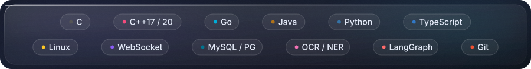
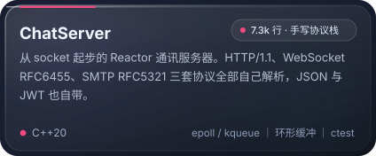
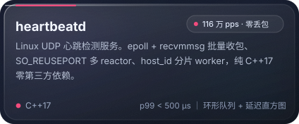
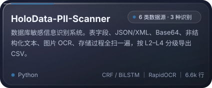
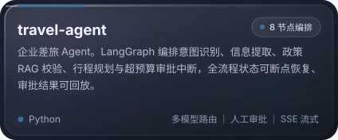

  

 

## 关于我

写代码的时候，我偏爱两头：一头往下，扎进 `epoll`、协议字节和分片队列，把机器的余量榨出来；
一头往上，做会自己判断下一步的 Agent，让它不只回答问题，而是把事办完。

中间那层花活儿我尽量少留 —— 能测量的写数字，测不出来的写边界。

- **系统与性能**：C++20 服务端、Reactor 事件循环、手写协议解析、尾延迟直方图
- **数据与安全**：敏感信息识别、OCR / NER 落地、数据库侧扫描
- **智能体工程**：LangGraph 多节点编排、RAG 政策校验、人机协同审批
- **工程习惯**：单测、压测脚本、CI 冒烟；压力测试报告里连机器型号一起写
- **正在啃**：xv6 操作系统实验、Java 中间件、并发模型

 

  

 

## 精选项目

<table>
  <tr>
    <td align="center" width="50%">
      
    </td>
    <td align="center" width="50%">
      
    </td>
  </tr>
  <tr>
    <td align="center" width="50%">
      
    </td>
    <td align="center" width="50%">
      
    </td>
  </tr>
</table>

### 各自的难点在哪

**ChatServer —— 手写三个协议栈。** `core` 是 EventLoop → Poller → Channel → Acceptor / TcpConnection
+ Timer，`protocol` 里 HTTP/1.1、WebSocket、SMTP 各自独立解析器，`service` 再叠用户、消息、频道、好友。
HTTP 侧要处理 `Content-Length` 与 `Connection` 语义，WebSocket 要接分片帧和关闭握手，SMTP 是完整的
会话状态机。不用 `muduo` 自己写一遍，才知道半包该攒在哪。

**heartbeatd —— 把内核批量接口吃满。** 32 字节 UDP 报文带稳定 `host_id` + 每次启动新生成的 `boot_id`
+ 递增序号，就能区分**上线 / 重启 / 超时离线**三种事件，不用付 TCP 握手或 ICMP 被封的代价。
4 receiver + 4 worker，loopback 压到 **116 万 pps 零丢包，p99 < 500 µs**；`kernel_dropped`
（该调 `SO_RCVBUF`）和 `queue_dropped`（该加队列或加 worker）分开计数，因为排查方向完全不同。

**HoloData-PII-Scanner —— 同一条数据，五条路径。** 一条身份证号可能藏在 MySQL 的 TEXT 字段、
导出的 JSON、Base64 编码的附件、一张扫描件图片，或者被拆成几段写进日志正文。七个扫描器
（结构化 / 半结构化 / 编码 / 文本 / OCR / 数据库对象 / SQL 遍历）共用一套「正则 + 校验码 → 分级」
的判定，模型用的是 CRF 与 BiLSTM-CRF，图片走 PP-OCRv4。工程上最难的是**别把样本数据带出门**：
仓库里连 `data/`、`output/`、`logs/` 都进 `.gitignore`，因为扫描器自己就是最危险的泄露源。

**travel-agent —— 把一次差旅拆成 8 个节点。** 意图识别用便宜的小模型，推理交给大模型；
政策校验走 RAG 检索企业差旅制度；一旦超预算就中断流程等人审批，审批完从断点恢复；
前端用 SSE 把节点状态和推荐卡片流式推出来。多智能体最容易写成一锅粥，这里是靠显式状态机
（`update_state` + checkpointer）管住的。

 

## 上游贡献

在别人的大项目里改代码，比在自己的仓库里堆功能更能照见自己的水平边界。

**[Tencent/WeKnora](https://github.com/Tencent/WeKnora)** — 开源 LLM 知识平台（Go）

| PR | 内容 | 状态 |
| :-- | :-- | :-- |
| [#4062](https://github.com/Tencent/WeKnora/pull/4062) | `fix(retrieval)`：summarize 意图不再走知识库检索 | 已合并 |
| [#4306](https://github.com/Tencent/WeKnora/pull/4306) | `fix(chat)`：失败的快捷问答轮次落库，刷新后错误不再丢失 | 已合并 |
| [#4390](https://github.com/Tencent/WeKnora/pull/4390) | `fix(embed)`：访客消息不再污染宿主上下文 | 未合并 |

**[open-telemetry/opentelemetry-java](https://github.com/open-telemetry/opentelemetry-java)** — OpenTelemetry Java SDK

- [#8953](https://github.com/open-telemetry/opentelemetry-java/pull/8953) `Include config document path in declarative config error messages`
  把「配置哪一项为空」的报错从 `batch span processor exporter is required but is null`
  变成 `.tracer_provider.processors[0].batch exporter is required but is null`，
  涉及 10 个工厂类的路径压栈与 4 个测试类改写（+358 / −167），审阅中。

 

## GitHub 数据

  
  

  

 

## 其他仓库

- [xv6-labs-2020](https://github.com/AstonKrss/xv6-labs-2020) — MIT 6.S081 操作系统实验，从页表到文件系统
- [fastshare](https://github.com/AstonKrss/fastshare) — 跨设备高速文件传输平台，Spring Boot 3 + Vue 3 + WebSocket
- [TestForge-agent](https://github.com/AstonKrss/TestForge-agent) — 自然语言驱动的 Web QA Agent，Playwright 多 Agent 协作
- [toolbox](https://github.com/AstonKrss/toolbox) — JavaSE 命令行工具箱，IO / 多线程 / 网络 / 设计模式的练习场
- [java_web](https://github.com/AstonKrss/java_web) — Java Web 与 Spring Cloud 微服务练习

**未公开**：个人博客系统（Next.js 15 + Spring Boot 3.2，前后端分离，含文章编辑、归档、后台管理），
因为配置里带密钥，仓库暂时私有。

 

  

 

**想聊性能优化、Agent 编排，或者只是想看看某个项目的实现细节 —— 都欢迎。**

[个人主页](https://astonkrss.github.io/) ｜ [GitHub](https://github.com/AstonKrss) ｜ [提 Issue](https://github.com/AstonKrss/heartbeatd/issues)

